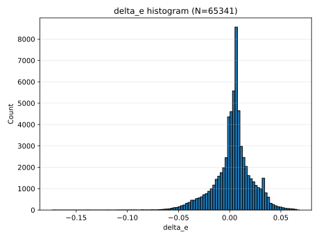

# 3-Body AB+C Simulator

Hierarchical three-body system (inner binary AB + outer body C).
**Python + PyQt6**.

## Features (current version)

- Input of all system parameters (masses, orbital elements)
- Load / save configurations in YAML
- Integrators: **REBOUND** IAS15 (high accuracy) and WHFast (fast)
- 3D trajectories (OpenGL)
- XY projection, body separations, energy conservation
- Background thread execution (UI stays responsive)
- **Two run modes** (menu *Mode*):
  1. **Single run** — interactive plots
  2. **Statistic run** — parameter scan (☑ → Start/End/Step), parallel batch via
     `ProcessPoolExecutor` (`spawn`, Windows/macOS/Linux), results table
     (`I_last_min`, `L_in_0/f`, `E_0/f`, `delta_e`). Export to CSV.
     Field **Workers (0=auto)** sets the process pool size.

## Installation

```bash
cd 3body_simulator
python -m venv env
  source env/bin/activate      # Linux/macOS
  env\Scripts\activate         # Windows

pip install -r requirements.txt
```

## Usage

```bash
python main.py
```

### Fill missing statistic results

To calculate empty `Δe_in`, `σ`, and `SE` cells in a statistic CSV and save
the file after each completed row. A separate detailed per-simulation CSV is
saved beside it for each processed row, using the same descriptive filename
format as **File → Export Statistic table**:

```bash
python run-stats.py results/results.csv
```

The script uses the Statistic-mode defaults (`IAS15`, `dt=0.04`, 5000 output
points) and automatically selects the worker count. Use `--workers N` to set
it explicitly. The calculated values use only successful `Break at:` runs
without internal breakup and with finite `delta_e`; the detailed CSV still
contains all runs. If none qualify, missing cells remain empty and a warning
is printed. Existing non-empty cells are not recalculated.

### Histogram of statistic results

The **Summary** tab shows a histogram of the inner eccentricity change
(`delta_e = e_in(final) - e_in(initial)`) beside **Configuration**, above
**Results**. Use **Bins** to change the number of bins (default: 50) and
**Export PDF** to save a vector figure with publication-style labels.
The histogram and Summary statistics include only successful `Break at:` runs
without internal breakup and with finite values, excluding `Stable at T_max`
and `Total break at:` rows. The same rule applies to imported CSV data; the
table retains all rows and other result plots keep their existing rules.

Plot a histogram of `delta_e` for `Break at:` rows from an exported CSV:

```bash
python diagram.py "full-results.csv"
python diagram.py "full-results.csv" --bins 100 --output histogram.svg
```



By default, the histogram opens in a window with 50 bins. `--output` saves
an image without opening a window. Empty and non-finite values (`nan`, `inf`)
in matching rows are skipped with a warning; missing `delta_e` or
`stability_status` columns and invalid numbers in matching rows report an error.
Only the `delta_e` values are retained in memory, not the entire CSV table.

## Structure

```
3body_simulator/
├── main.py                 # entry point
├── diagram.py              # delta_e histogram from a statistic CSV
├── core/
│   ├── constants.py        # unit definitions
│   ├── kepler.py           # elements → Cartesian coordinates
│   ├── simulation.py       # integrators
│   ├── batch.py            # parallel statistic worker
│   └── config.py           # load/save YAML
├── ui/
│   ├── main_window.py
│   ├── parameter_widget.py
│   ├── statistic_parameter_widget.py
│   └── plot_widget.py
├── configs/
│   └── default.yaml
└── results/
```

## Unit system

- Mass — M☉
- Length — AU
- Time — 1 year = 2π (G = 1)

## Roadmap

- [ ] GR corrections (1PN, 2.5PN) with on/off toggle
- [X] Batch / statistic mode (parameter scan)
- [X] Export results (CSV)
- [ ] Standalone application build (PyInstaller)
